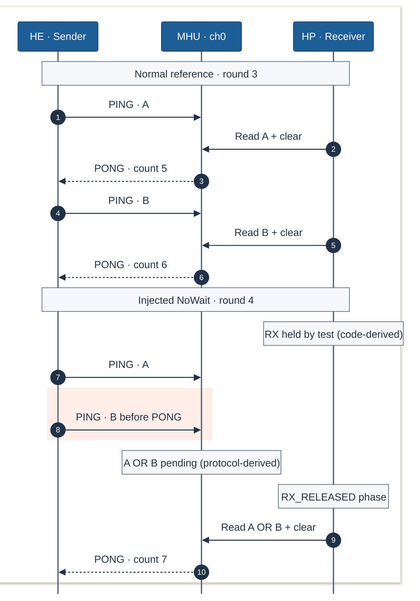

# Ping-pong: reusing the channel before completion

**The test deliberately skips the first completion wait in rounds 4 and 9.** While HP reception is held, HE writes A and B to the same MHU bit-set channel. HP then reads `A OR B` once; two distinct words become one received value. This reproduces unsafe channel reuse in the hardware capture of `DevKit-E7-NoWaitMulti` from 2026-10-28.

**12 rounds · 24 writes → 22 reads, clears and completions.** Ten normal rounds preserve A and B separately. The captured HP result is PASS because the test expects the injected behavior; it reports twelve completed rounds, 22 receives and zero API/callback errors or fault flags.

## General behavior and comparison

HE sends a word on channel 0. HP reads it in the receive ISR, invokes the receive callback and clears the channel. The sender callback increments `trace_tx_ack_count`; normal code waits for that completion before sending the next word. A is `0x11111111`, B is `0x22222222`, and their OR is `0x33333333`.

The shared comparison uses normal round 3 and representative NoWait round 4. Round 9 repeats the same mechanism and is included in the evidence below.

PING denotes the payload write. **PONG denotes the observed HE completion-counter write**, not reply data or the exact hardware-ACK instant. Its arrow depicts the completion dependency. Read/clear combines two observed accesses; the callback lies between them in the driver source. Schematic protocol order; independent clocks; not to scale.

## Where the issue enters

The first relevant divergence is in [`trace_run_he`](../../Examples/IPM_ARM_MHUv2/trace_no_wait.c), lines 325–331: `if (!no_wait)` skips the wait after A, so B reuses channel 0 before the first completion. The corresponding normal round has a captured completion between its two writes.

The test makes this deterministic in `trace_run_hp`, lines 270–286: it disables RX before sending START_NO_WAIT and releases reception only after BURST_DONE. HE sends that token after both payload writes and `DSB` (lines 322–335). Matching round IDs, phase markers and this serialized control handshake support the cross-core association; global CSV row order does not.

MHU channel writes set bits: writing one sets a bit, and zero leaves it unchanged. With the protocol-derived empty starting state, two pending writes produce **inferred `A OR B` state**. The subsequent HP read of `0x33333333` is directly observed. Prior clears/completions and the receiver gate support the inference; the intermediate pending state was not sampled. This demonstration does not imply that arbitrary consecutive writes always merge.

The register interpretation was checked through CMSIS Developer Assistant against `AlifSemiconductor::Ensemble@2.2.1`, SVD `AE722F80F55D5LS_CM55_HE_View`: CH_SET at `0x4009000c` sets bits, CH_ST at `0x40090000` retains them until clear, and the HP-view CH_CLR at `0x40080008` clears written-one bits.

To preserve separate words, wait for completion before reusing the channel. If several messages must be outstanding, use a queue with explicit ownership and acknowledgments.

## Evidence and limits

Physical [CSV](ipm-ping-pong-multi-2026-10-28.csv) lines include the header as line 1. Each read below is followed by one all-ones clear on HP; each completion is a counter write on HE.

| Round | HE writes A / B | HP reads / clears | HE completions; counter |
| --- | --- | --- | --- |
| 3 · normal | 3856 / 3869 | 3852, 3865 / 3853, 3866 | 3858, 3871; 4 → 6 |
| 4 · NoWait | 3917 / 3918 | 3930 / 3931 | 3934; 6 → 7 |
| 9 · NoWait | 4249 / 4250 | 4263 / 4264 | 4267; 15 → 16 |

Across all twelve rounds, the ten normal rounds each contain two writes, reads, clears and completions. Rounds 4 and 9 each contain two writes but one read, clear and completion. All 22 completion-counter writes are contiguous values 1–22, with no observed reset, wrap or jump; the initial zero is source-derived.

The recorded acquisition used AC6 6.24.0 and ULINKplus `L39352482A`; the snapshot was taken at **2026-10-28 10:28:20 UTC**. Its pyTS 1.0.0 profile mapped the following four-byte accesses:

| Stream | DWT0 | DWT1 | DWT2 | DWT3 |
| --- | --- | --- | --- | --- |
| 1 · HE | CH0_SET write, `0x4009000c` | `trace_demo_round` write | `trace_demo_phase` write | `trace_tx_ack_count` write |
| 2 · HP | CH0_ST read, `0x40080000` | CH0_CLR write, `0x40080008` | `trace_demo_round` write | `trace_demo_phase` write |

Round markers contain value only; the other comparators record PC and value. The [symbolic NoWaitMulti profile](../../Examples/IPM_ARM_MHUv2/.cmsis/ipm_arm_mhuv2-ac6+DevKit-E7-NoWaitMulti.ctrace.yml) is the current project configuration, not an archived generated capture profile. Source attribution relies on the recorded acquisition association and identities below; no new binary-to-source check was performed.

Recorded source identities (SHA-256)

| Source | SHA-256 |
| --- | --- |
| [NoWait firmware](../../Examples/IPM_ARM_MHUv2/trace_no_wait.c) | `0dc9a52654061080ba956149bfda30f185a72c4dba54764e40fa00372401ac94` |
| [AC6 solution](../../Examples/IPM_ARM_MHUv2/ipm_arm_mhuv2-ac6.csolution.yml) | `ade0bd83318fa5554f09e15ecd358e2919247d1ec14b529c1af19de013c35186` |
| [NoWait configuration](../../Examples/IPM_ARM_MHUv2/trace_no_wait_config.cmake) | `ed55515352d3d346be9d38d465e90f2431fdd8d6d495a3209acc82b8768e7b1f` |
| [MHU driver at recorded SDK commit](https://github.com/alifsemi/zephyr_alif/blob/3a2b84d96961b53431a78685c6ec0f0df4ddf347/drivers/ipm/ipm_arm_mhuv2.c) | `8e3b860c0c3c892369ded51a60de08e31522996039c6e97ac7f423dd5c6f39b0` |

Repository-relative links follow the checkout; these hashes identify the source reviewed for this capture.

All expected mapped events are present for the twelve rounds. Boundary decoder info at CSV2/4496 reports skipped bytes; there are no error/overflow records. This does not prove globally lossless capture. HE and HP clocks have no verified synchronization relation, so cross-core latency is unmeasured.

CSV SHA-256: `0763da8af8cd8e004d739b202a0c94bc5545ff93026a6298e3ef988d44add39c`.
