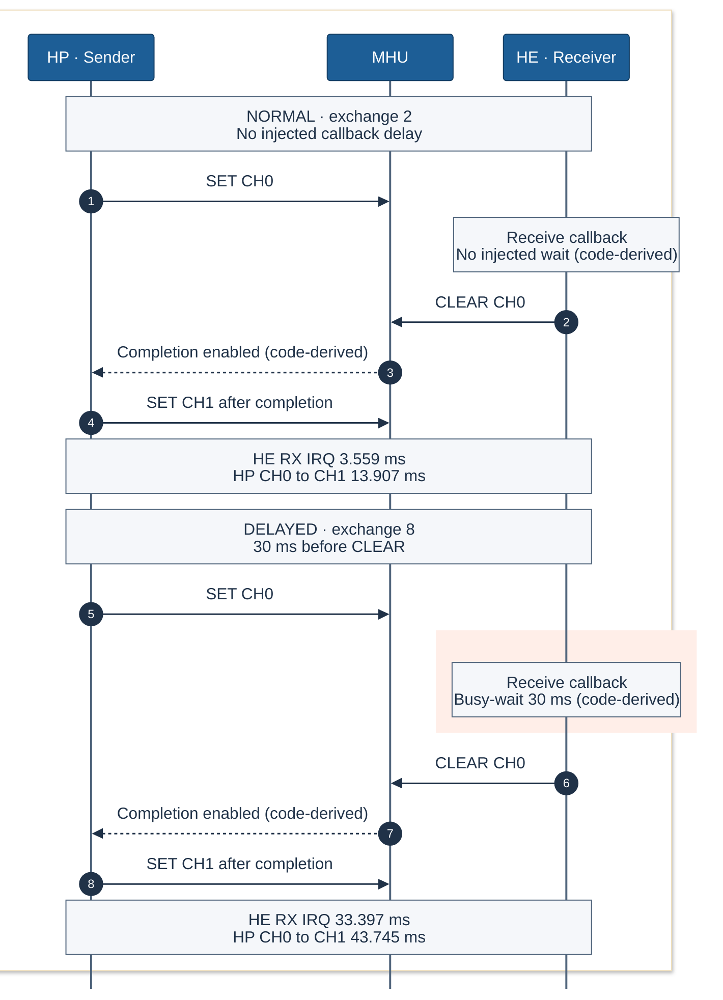

# Trace Delay Multi: why a late CLEAR delays the next send

The hardware trace shows two **deliberately injected HE receive delays**: **15 ms at exchange #3** and **30 ms at #8**. Both occur before the receiver clears channel 0, postponing HP's completion condition and next send. This demonstrates the callback dependency; no unintended MHU defect is established.

## General operation: normal versus delayed

HP writes CH0 and waits for `msg_sent` before writing CH1. On HE, the RX driver reads the channel, calls `recv_cb`, then writes CLEAR. Cleared channel status permits HP's TX callback to set `msg_sent`. HE's reverse-direction application data is a separate exchange, not this acknowledgment condition.

The comparison uses normal exchange **#2** and the longer injected case **#8**. SET/CLEAR writes and local durations are observed; callback work and completion dependencies are source-derived. **Schematic protocol order; independent clocks; not to scale.**

## Where the delay occurs

The narrow source location is [`k_busy_wait(delay_us)` in HE `recv_cb`](../../Examples/IPM_ARM_MHUv2/rtss_he/src/for_rtss_hp_mhu0.c#L62), called within the RX ISR. The [TraceDelayMulti target](../../Examples/IPM_ARM_MHUv2/ipm_arm_mhuv2-ac6.csolution.yml#L65) selects twelve rounds and the two waits; [HE compile definitions](../../Examples/IPM_ARM_MHUv2/trace_demo_config.cmake#L35) apply them to that core.

The [RX driver](https://github.com/alifsemi/zephyr_alif/blob/3a2b84d96961b53431a78685c6ec0f0df4ddf347/drivers/ipm/ipm_arm_mhuv2.c#L289) executes **read → callback → CLEAR**. HP's [send loop](../../Examples/IPM_ARM_MHUv2/rtss_hp/src/for_rtss_he_mhu0.c#L54) waits between CH0 and CH1; its [`send_cb`](../../Examples/IPM_ARM_MHUv2/rtss_hp/src/for_rtss_he_mhu0.c#L42) sets the flag when the [TX driver's cleared-status condition](https://github.com/alifsemi/zephyr_alif/blob/3a2b84d96961b53431a78685c6ec0f0df4ddf347/drivers/ipm/ipm_arm_mhuv2.c#L239) permits completion. Extra work inside HE's callback therefore delays CLEAR and HP's next send. IRQ exit is a separate event from channel clear and sender completion.

| Case | Configured wait | Entire HE CH0 RX handler | HP CH0 SET → CH1 SET | HE entry / CLEAR / exit CSV lines | HP SET CSV lines |
| --- | ---: | ---: | ---: | --- | --- |
| #2, normal reference | 0 ms | 3.558963 ms | 13.907483 ms | 97 / 98 / 99 | 96 / 116 |
| #3, injected | 15 ms | 18.396750 ms | 28.745410 ms | 140 / 141 / 142 | 139 / 161 |
| #8, injected | 30 ms | 33.396500 ms | 43.745100 ms | 356 / 358 / 359 | 352 / 374 |

Physical [CSV](ipm-trace-delay-multi-2026-10-28.csv) lines include the header as line 1. The other ten HE CH0 handlers have median **3.558959 ms**. All twelve complete spans enter the outlier calculation: median **569,434 cycles**, MAD **1.5 cycles**, threshold **854,151 cycles** under the skill's robust rule; only #3 and #8 exceed it. No partial span is excluded. A statistical reference is not a correctness budget.

Measured handler durations include callback, logging and other IRQ work. HP send spacing includes intervening work. Neither quantity isolates the configured busy-wait or measures ACK latency; the trace does not capture the wait's own boundaries.

## Continuous event timeline

One **continuous HE-local axis** shows all twelve CH0 receives, including the normal intervals between both findings. Blue bars are ordinary measured IRQ spans; red **#3 and #8** contain the configured **15 ms and 30 ms** waits. Diamonds mark observed CLEAR events.

```mermaid
%% trace-view: {"kind": "timeline", "timebase": "HE", "origin_cycles": 81964428, "unit": "ms", "scope": "All twelve HE CH0 receive operations in the captured run", "intervals": ["HE.rx.ch0.1", "HE.rx.ch0.2", "HE.rx.ch0.3", "HE.rx.ch0.4", "HE.rx.ch0.5", "HE.rx.ch0.6", "HE.rx.ch0.7", "HE.rx.ch0.8", "HE.rx.ch0.9", "HE.rx.ch0.10", "HE.rx.ch0.11", "HE.rx.ch0.12"], "events": ["HE.ch0.clear.1", "HE.ch0.clear.2", "HE.ch0.clear.3", "HE.ch0.clear.4", "HE.ch0.clear.5", "HE.ch0.clear.6", "HE.ch0.clear.7", "HE.ch0.clear.8", "HE.ch0.clear.9", "HE.ch0.clear.10", "HE.ch0.clear.11", "HE.ch0.clear.12"]}
%%{init: {"theme":"base","themeVariables":{"fontFamily":"Arial, sans-serif","fontSize":"20px","background":"#FFFFFF","primaryTextColor":"#203248","sectionBkgColor":"#F2F5F9","altSectionBkgColor":"#FFFFFF","sectionBkgColor2":"#FFFFFF","gridColor":"#DCE4ED","taskBkgColor":"#1D5E96","taskBorderColor":"#1D5E96","taskTextColor":"#FFFFFF","taskTextOutsideColor":"#203248","taskTextDarkColor":"#203248","taskTextLightColor":"#FFFFFF","critBkgColor":"#BF4936","critBorderColor":"#BF4936"},"gantt":{"useMaxWidth":true,"useWidth":1400,"displayMode":"compact","barHeight":32,"barGap":12,"topPadding":44,"leftPadding":180,"rightPadding":80,"gridLineStartPadding":32,"fontSize":18,"sectionFontSize":18,"numberSectionStyles":2},"themeCSS":"svg {background:#FFFFFF;} .task {rx:7px;ry:7px;stroke-width:1.5px;} .taskText,.taskTextOutsideLeft,.taskTextOutsideRight {font-family:Arial,sans-serif!important;font-weight:700!important;} .sectionTitle {fill:#203248!important;font-weight:700!important;} .titleText {fill:#203248!important;font-family:Arial,sans-serif!important;font-size:20px!important;font-weight:700!important;} .grid .tick line,.grid .domain {stroke:#DCE4ED!important;} .tick text {fill:#50657C!important;font-family:Arial,sans-serif!important;font-size:16px!important;}"}}%%
gantt
    title HE CH0 receive events · local time (ms)
    accTitle: HE CH0 receive events · local time (ms)
    accDescr: All twelve HE channel-0 receive IRQ intervals on a continuous local axis from first entry to last exit at 354.042 ms. Separate diamonds mark observed CLEAR events. Red intervals 3 and 8 contain configured 15 and 30 ms waits whose exact boundaries were not captured. No cross-core time alignment is implied.
    dateFormat x
    axisFormat %s ms
    tickInterval 20second
    todayMarker off
    %% Relative coordinates: 1000 Date milliseconds = 1 displayed unit.
    %% Positions round to 0.001 displayed units. Calendar dates have no meaning.
    section RX IRQ spans
    %% Evidence: {"id": "HE.rx.ch0.1", "lines": [59, 63]}
    #1 :v1, 0, 3398
    %% Evidence: {"id": "HE.rx.ch0.2", "lines": [97, 99]}
    #2 :v2, 27656, 31215
    %% Evidence: {"id": "HE.rx.ch0.3", "lines": [140, 142]}
    #3 :crit, v3, 55471, 73868
    %% Evidence: {"id": "HE.rx.ch0.4", "lines": [186, 188]}
    #4 :v4, 98124, 101683
    %% Evidence: {"id": "HE.rx.ch0.5", "lines": [229, 231]}
    #5 :v5, 125940, 129499
    %% Evidence: {"id": "HE.rx.ch0.6", "lines": [269, 271]}
    #6 :v6, 153755, 157314
    %% Evidence: {"id": "HE.rx.ch0.7", "lines": [312, 314]}
    #7 :v7, 181570, 185129
    %% Evidence: {"id": "HE.rx.ch0.8", "lines": [356, 359]}
    #8 :crit, v8, 209385, 242782
    %% Evidence: {"id": "HE.rx.ch0.9", "lines": [399, 403]}
    #9 :v9, 267038, 270597
    %% Evidence: {"id": "HE.rx.ch0.10", "lines": [446, 448]}
    #10 :v10, 294853, 298412
    %% Evidence: {"id": "HE.rx.ch0.11", "lines": [486, 488]}
    #11 :v11, 322668, 326227
    %% Evidence: {"id": "HE.rx.ch0.12", "lines": [528, 531]}
    #12 :v12, 350483, 354042
    section CLEAR events
    %% Evidence: {"id": "HE.ch0.clear.1", "lines": [62]}
    #1 :milestone, v13, 3397, 0ms
    %% Evidence: {"id": "HE.ch0.clear.2", "lines": [98]}
    #2 :milestone, v14, 31214, 0ms
    %% Evidence: {"id": "HE.ch0.clear.3", "lines": [141]}
    #3 :milestone, v15, 73867, 0ms
    %% Evidence: {"id": "HE.ch0.clear.4", "lines": [187]}
    #4 :milestone, v16, 101683, 0ms
    %% Evidence: {"id": "HE.ch0.clear.5", "lines": [230]}
    #5 :milestone, v17, 129498, 0ms
    %% Evidence: {"id": "HE.ch0.clear.6", "lines": [270]}
    #6 :milestone, v18, 157314, 0ms
    %% Evidence: {"id": "HE.ch0.clear.7", "lines": [313]}
    #7 :milestone, v19, 185129, 0ms
    %% Evidence: {"id": "HE.ch0.clear.8", "lines": [358]}
    #8 :milestone, v20, 242781, 0ms
    %% Evidence: {"id": "HE.ch0.clear.9", "lines": [402]}
    #9 :milestone, v21, 270596, 0ms
    %% Evidence: {"id": "HE.ch0.clear.10", "lines": [447]}
    #10 :milestone, v22, 298411, 0ms
    %% Evidence: {"id": "HE.ch0.clear.11", "lines": [487]}
    #11 :milestone, v23, 326227, 0ms
    %% Evidence: {"id": "HE.ch0.clear.12", "lines": [530]}
    #12 :milestone, v24, 354042, 0ms
```

Time zero is the first plotted RX entry: **CSV59, cycle 81,964,428**, at configured **160 MHz**. The final exit is **354.042344 ms** later. Plot positions round to **1 µs**. CLEAR precedes each CH0 IRQ exit by **95 cycles (0.594 µs)**, so the two boundaries visually coincide at this scale. The highlighted bars show the whole handler, without inventing internal wait segments.

## Evidence, limits and practical consequence

The recorded producing-profile mapping is stream 1/2 → HE/HP. On both cores, DWT 0/1 observe CH0/CH1 SET at `0x4009000c`/`0x4009002c`; DWT 2/3 observe CLEAR at `0x40080008`/`0x40080028`. All are four-byte writes with PC and value. Exceptions 57/58 record RX/TX, with values 1/2/3 meaning entry/exit/return; return records are not additional exits. The [symbolic TraceDelayMulti profile](../../Examples/IPM_ARM_MHUv2/.cmsis/ipm_arm_mhuv2-ac6+DevKit-E7-TraceDelayMulti.ctrace.yml) is the current project configuration, not an archived generated capture profile.

The capture has **48 SETs, 48 CLEARs, 48 complete RX intervals and 94 complete TX intervals**: twelve SET/CLEAR writes per core and channel, with no unmatched IRQ endpoints. A TX IRQ is not automatically one completion.

Associations use the serialized source protocol and mapped-event coverage; round IDs were not captured. HE/HP durations use configured **160/400 MHz**, without calibration or cross-core synchronization. Diagram positions do not measure cross-core chronology or latency. Boundary decoder info at CSV2/1241 reports skipped bytes; no error/overflow is decoded, which does not establish globally lossless capture. Payload reads, callback boundaries and completion-flag writes are unobserved.

The acquisition used AC6 6.24.0, ULINKplus `L39352482A`, CMSIS Debugger 1.10.0 and pyTS 1.0.0. At the snapshot, HP was in `arch_cpu_idle` with HFSR/CFSR zero; execution resumed afterward. The recorded acquisition association and source identities below support the explanation; no new binary-to-source verification was performed.

Recorded source identities (SHA-256)

| Source | SHA-256 |
| --- | --- |
| [AC6 solution](../../Examples/IPM_ARM_MHUv2/ipm_arm_mhuv2-ac6.csolution.yml) | `ade0bd83318fa5554f09e15ecd358e2919247d1ec14b529c1af19de013c35186` |
| [HE receiver](../../Examples/IPM_ARM_MHUv2/rtss_he/src/for_rtss_hp_mhu0.c) | `5f93b4e69e01f58b4bf057d65439641bf2f9a82c416371282fa74ea19088e8bd` |
| [HP sender](../../Examples/IPM_ARM_MHUv2/rtss_hp/src/for_rtss_he_mhu0.c) | `979923a17a06d8cdaa986e2f1a31537bf445156f5e20fcffccc9ff61f9aacc08` |
| [MHU driver at recorded SDK commit](https://github.com/alifsemi/zephyr_alif/blob/3a2b84d96961b53431a78685c6ec0f0df4ddf347/drivers/ipm/ipm_arm_mhuv2.c) | `8e3b860c0c3c892369ded51a60de08e31522996039c6e97ac7f423dd5c6f39b0` |

Repository-relative links follow the checkout; these hashes identify the source reviewed for this capture.

For ordinary operation, disable `TRACE_DEMO_RX_DELAY`. If real receive work takes this long, keep the ISR callback bounded: copy data into owned storage and defer processing/logging to a thread or workqueue with an explicit completion policy.

Capture: hardware, **2026-10-28**, `DevKit-E7-TraceDelayMulti`. CSV SHA-256: `c799b6b19aeeb9d8e7c9067816611990ca17a28538fbf8a3d01d285eb2da9993`.
